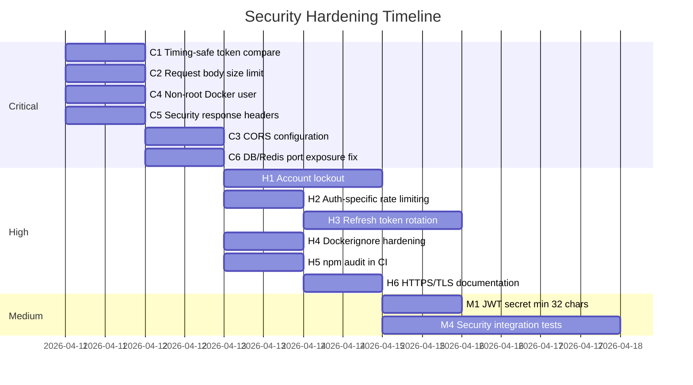

==== ONE ====
AUTHENTICATION
[ ] Passwords hashed with bcrypt or argon2 (minimum 12 rounds)
[ ] Tokens stored in httpOnly cookies — not localStorage
[ ] JWT secret is random, at least 32 characters, not from a tutorial
[ ] Access tokens expire (15 to 60 minutes max)
[ ] Refresh token rotation implemented
[ ] Rate limiting on /login and /register
[ ] Account lockout after repeated failures
[ ] Sessions invalidated server-side on logout
[ ] Email verification required before access granted

API SECURITY
[ ] Every route verified for authentication (check all endpoints, not just obvious ones)
[ ] Authorization checked: each user can only access their own data
[ ] All request inputs validated with schema validation (Zod, Joi, etc.)
[ ] API responses never include passwords, hashes, or internal fields
[ ] Error messages don't reveal system internals or file paths
[ ] Rate limiting on all public-facing endpoints
[ ] CORS restricted to your domain (not wildcard *)
[ ] HTTPS enforced, HTTP redirected

DATABASE
[ ] No SQL string concatenation (use parameterized queries or ORM)
[ ] Application uses a limited-permission DB user, not root
[ ] Database not publicly accessible (behind VPC or firewall rule)
[ ] Backups configured and restore has been tested (not just backup)
[ ] Sensitive fields encrypted at rest

INFRASTRUCTURE
[ ] All secrets in environment variables, not source code
[ ] .env not in git history (run: git log -- .env)
[ ] SSL certificate installed and valid
[ ] Server not running as root user
[ ] Only ports 80 and 443 publicly accessible

CODE
[ ] No console.log statements in production build
[ ] `npm audit` run, all critical vulnerabilities resolved
[ ] No hardcoded credentials anywhere in the codebase


==== TWO ====   
> no auth on "internal" endpoints — if it has a URL, it can be hit from outside
> returning full DB objects — leaking password hashes, admin roles, internal flags
> no rate limiting — your API can be scraped and DoS'd with zero friction
> file uploads accepting any MIME type — validate server-side, not the extension
> missing input validation — null, undefined, strings where numbers expected
> verbose errors in production — stack traces and SQL errors in response body
> CORS wildcard (*) in production — any site can make requests using your users cookies
> HTTP without redirect — credentials sent in plaintext on any network
> HTTP verbs misused — DELETE triggered via GET, cached by browsers
> sensitive data in query params — `/api/reset?token=abc` gets logged everywhere
> no authorization, only authentication — change an ID in the URL, access any users data
> no API versioning — one breaking change kills all existing clients

==== THREE ====
1/ no .env.example file
> new dev joins. cant run the app. nobody knows what env vars exist.
2/ API keys in git history
> deleted from .env doesn't mean deleted from history. rotate those keys.
3/ no README with setup instructions
> three steps to run locally that only you know.
4/ functions with 500+ lines
> AI fills files. nobody splits them. untestable, unreadable, unmaintainable.
5/ catch blocks that swallow the error
> silent failures. user sees nothing. you get no alerts. bug persists.
6/ hardcoded localhost URLs
> breaks in staging. breaks in production. search "localhost" in the repo right now.
7/ no TypeScript or type definitions
> you refactor one prop and nothing tells you about the 12 places it broke.
8/ console.log statements in production
> performance overhead and sensitive data leaking into browser consoles.
9/ zero tests
> you change one utility function and don't know what broke until a user tells you.
10/ missing loading and error states in the UI
> API call takes 3 seconds. user sees blank screen and refreshes. request fires twice.
11/ dead code everywhere
> AI generates functions. AI forgets them. nobody knows whats active.
12/ no linting or formatting config
> every file has different indentation. code reviews become style arguments.
13/ mixed naming conventions
> camelase, snake_case, PascalCase. all from AI. all in the same repo.
14/ god components doing everything
> 500-line React components handling state, data fetching, and UI simultaneously.
15/ DB queries directly in route handlers
> business logic tangled with framework code. change one thing, you touch everything.
16/ secrets in committed config files
> not .env. config.js or settings.json that didnt seem like a secret file.
17/ no CI/CD pipeline
> deploy = "i hope nothing breaks." you find out in production.
18/ direct DOM manipulation inside React
> mixing jQuery patterns with React. breaks silently on re-renders.
19/ state mutated directly
> `state.items.push(item)` instead of a new array. causes unpredictable renders.
20/ memory leaks from uncleaned intervals
> setInterval inside useEffect with no cleanup. fires after the component unmounts.
21/ blocking the event loop with sync operations
> `fs[.]readFileSync` in a request handler. one request pauses all others.
22/ no pagination on list endpoints
> fetch all 50,000 records to display 20. works fine in dev with 5 test rows.
23/ missing Content-Type headers on API responses
> clients parse JSON as text. debugging nightmare across different clients.
24/ no error boundary in React
> one uncaught error in a child component crashes the entire app.
25/ inconsistent API response shapes
> some endpoints return `{data: {}}`. others return the object directly. good luck building a client.


==== FOUR ====
"Write security-focused integration tests for this API.
Cover:
1. Unauthenticated requests return 401 on all protected routes
2. User A cannot access User B's resources by changing an ID (IDOR test)
3. Rate limiting triggers after [N] requests to auth endpoints
4. SQL injection payloads are handled safely (test with: ' OR '1'='1)
5. Password fields never appear in any response body
6. Expired tokens are rejected correctly
7. Input validation: test null, undefined, empty string, oversized strings, and special characters on every field
Use [Jest / Vitest]. Structure as integration tests hitting the actual route handlers.
Mock the database layer only."

==== FIVE ====
"Review this entire codebase for security vulnerabilities. Check for:

1. Exposed secrets, API keys, or credentials anywhere in the code
2. API routes missing authentication middleware
3. Missing input validation or sanitization on request parameters
4. SQL injection via string concatenation instead of parameterized queries
5. CORS misconfigurations (wildcard origins in production)
6. Sensitive fields returned in API responses (passwords, hashes, internal flags)
7. JWT or tokens stored in localStorage instead of httpOnly cookies
8. Auth endpoints with no rate limiting
9. Authorization checks: can user A access user B's data by changing an ID?
10. Hardcoded credentials, default passwords, or test accounts
For each issue found: show the file name, line number, and the exact fix.
Prioritize results by severity: Critical, High, Medium, Low."


==== SIX ====
1/ API keys hardcoded in frontend JS
> anyone who opens devtools can read them
> cursor does this constantly
> move all keys to your backend, never the client
2/ no rate limiting on /login
> bots can try 10,000 combos while you sleep
> add rate limiting + lockout after 5 failed attempts
> this is table stakes, not optional
3/ SQL queries built with string concatenation
> "SELECT * FROM users WHERE id=" + userId
> thats SQL injection waiting to happen
> use parameterized queries, always
4/ CORS set to wildcard (*)
> any website can make authenticated requests to your API
> it uses your users own cookies to do it
> whitelist specific origins only
5/ JWTs stored in localStorage
> one XSS attack steals every token on your site
> localStorage is readable by any script on the page
> use httpOnly cookies instead
6/ JWT secret is "secret" or from a tutorial
> attackers test common secrets first
> yours is probably on a wordlist already
> generate a 256-bit random secret, rotate it
7/ admin routes protected only in the frontend
> the server doesnt care about your React Router guards
> hit the endpoint directly and it opens right up
> protect every route server-side, no exceptions
8/ .env committed to git even once
> its in the history even if you deleted the file
> git log --all --full-history -- .env finds it instantly
> rotate every key in that file immediately
9/ error responses showing stack traces or DB table names
> you're giving attackers a map of your infrastructure
> log errors server-side, return generic messages client-side
> never expose internals in a response
10/ file uploads with no MIME type validation
> upload a server-side script, get full access
> extension checks alone dont protect you
> validate MIME type server-side, not the filename
11/ passwords hashed with MD5 or SHA1
> rainbow tables crack MD5 in seconds
> no salt = no protection
> use bcrypt or argon2, no exceptions
12/ auth tokens that never expire
> stolen session = permanent access forever
> set an expiry on every token you issue
> implement refresh token rotation
13/ auth middleware missing on internal API routes
> AI adds middleware to obvious routes and skips the rest
> audit every single endpoint manually
> assume nothing is protected until you verify it
14/ server running as root
> one exploit = full system access
> run your app as a non-privileged user
> this costs nothing to fix
15/ database port exposed to the internet
> your postgres on port 5432 should never have a public IP
> put it behind a firewall or private network
> this is a one-click fix in most cloud providers
16/ IDOR vulnerability on resource endpoints
> change the ID in the URL
> can you access another users data? most vibe coded apps: yes
> validate ownership server-side on every resource request
17/ no HTTPS enforcement
> credentials sent over plain HTTP can be intercepted on any public network
> enforce HTTPS at the server level, not just the frontend
> redirect all HTTP traffic automatically
18/ sessions not invalidated on logout
> the old session token still works after the user clicks logout
> invalidate sessions server-side on every logout event
> client-side cookie clearing is not enough
19/ npm packages not audited since setup
> run npm audit right now
> count the criticals
> schedule this as part of every deploy
20/ open redirects in callback URLs
> used to send users to phishing sites through your trusted domain
> validate and whitelist every redirect destination
> never trust user-supplied redirect URLs


==== SEVEN ====
"Implement authentication for a production [Next.js / Express] app.
Requirements:
- JWT access tokens with 15-minute expiry
- Refresh tokens with 7-day expiry, rotated on every use
- Passwords hashed with bcrypt (salt rounds: 12)
- Tokens stored in httpOnly, Secure, SameSite=Strict cookies — not localStorage
- Rate limiting on /login and /register: 5 attempts per 15 mins per IP
- Account lockout after 10 failed attempts, unlocked via email
- Email verification required before access is granted
- Sessions invalidated on logout using server-side token blacklist
- Error messages must not reveal whether an email exists in the system
- Apply auth middleware at the router level, not individually per route
- Input validation on all fields before any processing
Do not store any token in localStorage. Do not return password or hash in any response.


=================== IMPLEMNETATION ======================
# Vibe Code Safety Audit — Implementation Plan

## Background

A systematic security audit of the Thesis fintech project against the `vibe_code_safety.md` checklist — a 7-section document covering authentication, API security, database, infrastructure, code quality, and testing patterns. This audit evaluates **every item** in the checklist against the current codebase state and recommends prioritized actions for a production app that **many users will use, backtest, and stress-test**.

---

## Current Security Posture — Summary

The project already has a **surprisingly solid foundation** for a vibe-coded app. Many items the checklist warns about are already handled correctly. Here's the honest assessment:

### ✅ What's Already Done Well (No Action Needed)

| Checklist Item | Current Status |
|---|---|
| Passwords hashed with bcrypt (12 rounds) | ✅ bcrypt via `bcryptjs`, cost=12, configurable via `BCRYPT_COST` |
| JWT secret minimum length enforced | ✅ `validateConfig()` enforces ≥16 chars |
| Access tokens expire (15 min default) | ✅ `ACCESS_TOKEN_TTL_SECONDS=900` |
| Refresh token TTL enforced | ✅ 30-day TTL, session-level revocation |
| Sessions invalidated server-side on logout | ✅ `revokeSession()` marks `revokedAt` in DB |
| Email verification before access | ✅ Verified check in `/auth/login` |
| All routes verified for authentication | ✅ Central `authenticateAccessToken()` gate at line ~7629 |
| Authorization: user can only access own data | ✅ `hasReportAccessForUser()`, all user queries scoped by `auth.userId` |
| Input validation on request params | ✅ Extensive inline validation (email, ticker, dates, integers, limits) |
| API responses never include passwords/hashes | ✅ No password/hash in any response; `buildUserProfile()` returns only safe fields |
| Error messages don't reveal system internals | ✅ Generic error messages; stack traces only in server-side logs |
| Rate limiting on public-facing endpoints | ✅ All non-`/internal/` routes rate-limited (Redis-backed) |
| No SQL string concatenation | ✅ All queries use parameterized `$1, $2, ...` via `pg` Pool |
| All secrets in env variables | ✅ No hardcoded secrets in source |
| `.env` not in git history | ✅ Confirmed `git log --all -- .env` returns empty |
| `.env.example` exists | ✅ 161-line template with all variables documented |
| No hardcoded credentials | ✅ No secrets found in source |
| TypeScript throughout | ✅ Strict TypeScript in all Node services |
| Structured logging (no raw `console.log`) | ✅ JSON structured logging via `logging.ts` |
| Consistent API response shape | ✅ All endpoints use `sendJson()` with `{error, error_message}` pattern |
| Parameterized queries only | ✅ All 6400+ lines of `store.ts` use parameterized queries |
| Internal endpoints protected by token | ✅ `x-internal-token` check on all `/internal/` routes |
| Audit trail | ✅ `appendAudit()` on all sensitive operations |
| CI pipeline exists | ✅ lint + typecheck + test in GitHub Actions |
| CD pipeline exists | ✅ deploy-production.yml with SSH-based deployment |
| ESLint configured | ✅ `eslint.config.mjs` in root |

---

## 🔴 CRITICAL — Must Fix Before Users Touch Production

These are items that could lead to **immediate data breach or service compromise** if exploited.

---

### C1. Internal token comparison is not timing-safe

**File:** [server.ts](file:///c:/BOTS/Thesis/fintech/apps/product-api/src/server.ts#L5277-L5285)

**Problem:** The internal token comparison uses `!==` string equality. An attacker with network access to the API could theoretically perform a timing side-channel attack to discover the `INTERNAL_WORKER_TOKEN` byte-by-byte.

```typescript
// Current (vulnerable)
if (internalToken !== runtime.config.internalWorkerToken) {
```

**Fix:** Use `crypto.timingSafeEqual()` for token comparison.

**Effort:** 10 minutes. Single function change.

---

### C2. No request body size limit

**File:** [server.ts](file:///c:/BOTS/Thesis/fintech/apps/product-api/src/server.ts#L820-L842) — `readJsonBody()`

**Problem:** `readJsonBody()` accumulates the entire request body into memory with no size cap. An attacker can send a 1GB POST body and exhaust server memory, causing a denial-of-service crash that takes down the entire API.

**Fix:** Add a maximum body size (e.g. 1MB) and reject requests exceeding it with `413 Payload Too Large`.

**Effort:** 15 minutes. Modify `readJsonBody()` to track `body.length`.

---

### C3. No CORS headers configured

**Problem:** The product-api sets **no CORS headers at all**. This is currently fine because the mobile app uses Bearer tokens (not cookies), but becomes a critical issue the moment a web client, admin dashboard, or web-based backtest tool is added. Any future web frontend would be blocked by the browser or — worse — if `Access-Control-Allow-Origin: *` is hastily added later, it becomes a real vulnerability.

**Fix:** Add explicit CORS headers. For now (mobile-only API), respond to OPTIONS preflight and set:
- `Access-Control-Allow-Origin`: your specific domain(s)
- `Access-Control-Allow-Methods`: `GET, POST, OPTIONS`
- `Access-Control-Allow-Headers`: `Authorization, Content-Type, X-Request-ID`

**Effort:** 30 minutes. Add CORS handling at the top of the request handler.

---

### C4. Docker containers run as root

**File:** [Dockerfile](file:///c:/BOTS/Thesis/fintech/apps/product-api/Dockerfile)

**Problem:** The Dockerfile has no `USER` directive, so the Node.js process runs as `root` inside the container. If an attacker exploits a vulnerability (e.g., a prototype pollution leading to RCE), they get full root access to the container, making lateral movement and host escape far easier.

**Fix:** Add a non-root user to every Dockerfile:
```dockerfile
RUN addgroup -S app && adduser -S app -G app
USER app
```

**Effort:** 15 minutes per Dockerfile (6 services = ~90 minutes total).

---

### C5. No security response headers

**Problem:** The API returns no security headers. While this is a REST API (not serving HTML), security headers still protect against click-jacking, MIME-sniffing, and XSS in any context where response content might be interpreted by a browser.

**Fix:** Add these headers globally in `sendJson()` or a wrapper:
- `X-Content-Type-Options: nosniff`
- `X-Frame-Options: DENY`
- `Strict-Transport-Security: max-age=31536000; includeSubDomains` (when HTTPS deployed)
- `Cache-Control: no-store` (for authenticated responses)

**Effort:** 20 minutes. Modify `sendJson()`.

---

### C6. Database and Redis ports exposed to host in docker-compose

**Files:** [docker-compose.yml](file:///c:/BOTS/Thesis/fintech/docker-compose.yml#L233-L249), [infra/docker-compose.yml](file:///c:/BOTS/Thesis/fintech/infra/docker-compose.yml#L182-L197)

**Problem:** Both `postgres:5432` and `redis:6379` are exposed to the host (and potentially the network) via `ports:` in both dev and production docker-compose files. In production on Hetzner, this means the database and Redis are reachable from the internet if no firewall blocks those ports. Redis has no authentication by default.

**Fix:**
- Dev compose: Keep as-is (needed for local tooling).
- Production compose: Remove `ports:` for redis and postgres, or bind to `127.0.0.1:5432:5432`.
- Add `requirepass` to Redis in production.
- Verify Hetzner firewall rules block ports 6379 and 5432 from public access.

**Effort:** 30 minutes for compose changes + firewall verification.

---

## 🟠 HIGH — Should Fix Before Public Beta

These won't cause an immediate breach but represent significant risk when users start hammering the app.

---

### H1. No account lockout after failed logins

**Problem:** The login endpoint has global rate limiting (120 req/60s across all endpoints), but no per-account lockout. An attacker can attempt ~120 passwords per minute per IP. With rotating IPs, there's essentially no brute-force protection.

**Fix:** Track failed login attempts per email in Redis. Lock account after 10 failures within 15 minutes. Return the same "Invalid credentials" message (no enumeration). Auto-unlock after the window expires.

**Effort:** 2–3 hours. New Redis-backed counter + integration with login flow.

---

### H2. Auth-specific rate limiting is too generous

**Problem:** Auth endpoints (`/auth/login`, `/auth/register`, `/auth/refresh`) share the same global rate limit (120 req/60s) as every other endpoint. The checklist recommends 5 attempts per 15 minutes for auth endpoints.

**Fix:** Add a stricter per-IP rate limit bucket specifically for auth routes. Example: 10 requests per 15 minutes per IP to `/auth/*`.

**Effort:** 1–2 hours. Extend `rateLimiter.check()` with route-specific thresholds.

---

### H3. No refresh token rotation

**Problem:** The checklist (sections ONE, SEVEN) specifically calls for refresh token rotation on every use. Currently, `/auth/refresh` re-issues access tokens but reuses the same session/refresh token without rotation. If a refresh token is stolen, the attacker has persistent access until the session expires.

**Fix:** On each refresh, revoke the old session, create a new session, and issue new access/refresh tokens. If a revoked refresh token is used again, revoke ALL sessions for that user (token family detection).

**Effort:** 3–4 hours. New session rotation logic + stolen token detection.

---

### H4. `COPY . .` in Dockerfile copies secrets and dev files

**File:** [Dockerfile](file:///c:/BOTS/Thesis/fintech/apps/product-api/Dockerfile#L7)

**Problem:** `COPY . .` copies the entire repo context into the Docker image, including `.env`, `secrets/`, test fixtures, and documentation. Even though `.dockerignore` exists (69 bytes — very minimal), the image likely contains more than it should.

**Fix:** Expand `.dockerignore` to exclude: `.env`, `secrets/`, `data/`, `tmp/`, `Project Note/`, `docs/`, `tests/`, `qa/`, `*.md`, `.git/`.

**Effort:** 20 minutes. Update `.dockerignore`.

---

### H5. `npm audit` not integrated into CI

**Problem:** Neither the CI pipeline (`ci.yml`) nor the deploy pipeline run `npm audit` or `pnpm audit`. Vulnerabilities in dependencies could ship to production undetected.

**Fix:** Add `pnpm audit --audit-level critical` as a CI step. Optionally add it as a pre-deploy check.

**Effort:** 15 minutes. Add one step to `ci.yml`.

---

### H6. No HTTPS enforcement logic

**Problem:** The product-api listens on plain HTTP. While HTTPS termination may happen at a reverse proxy (Nginx/Caddy on Hetzner), there's no redirect from HTTP to HTTPS, no `Strict-Transport-Security` header, and no documentation of the TLS termination strategy.

**Fix:** Document the TLS termination point. Add HSTS header. If no reverse proxy is configured yet, set up Caddy or Nginx with auto-TLS on Hetzner.

**Effort:** 1–2 hours depending on current Hetzner setup.

---

## 🟡 MEDIUM — Helpful Improvements for Hardening

These improve resilience and code quality but are not exploitable vulnerabilities in the current architecture.

---

### M1. JWT secret minimum should be 32+ characters (not 16)

**File:** [config.ts](file:///c:/BOTS/Thesis/fintech/apps/product-api/src/config.ts#L258-L260)

**Problem:** Config validation accepts JWT secrets as short as 16 characters. The checklist recommends 32+ random characters (256-bit).

**Fix:** Change validation threshold from 16 to 32. Update `.env.example` guidance.

**Effort:** 5 minutes.

---

### M2. Hardcoded `localhost` fallbacks in Python services

**Files:** [data-openbb/service.py](file:///c:/BOTS/Thesis/fintech/apps/data-openbb/src/service.py#L67), [news-ingest/service.py](file:///c:/BOTS/Thesis/fintech/apps/news-ingest/src/news_ingest/service.py#L132)

**Problem:** Python services have `redis://localhost:6379/0` as hardcoded defaults. Works in dev but could silently fail or connect to the wrong Redis in production if env vars are missing.

**Fix:** Require `REDIS_URL` explicitly in production mode (fail loud, not silent connect to wrong host).

**Effort:** 30 minutes.

---

### M3. No pagination limit enforcement on some list endpoints

**Problem:** Several `listBy*` store methods accept a `limit` parameter, but some callers pass large constants (e.g., `500` for kill-switch evaluations). In a stress-test scenario, these could return very large payloads.

**Fix:** Audit all list endpoints and ensure limits are capped (e.g., max 100 per page) with cursor-based or offset pagination.

**Effort:** 2–3 hours. Audit all list routes.

---

### M4. Add security-focused integration tests

**Problem:** The test suites cover functional behavior but not security-specific scenarios (as outlined in checklist section FOUR).

**Fix:** Create a `tests/security/` directory with tests covering:
1. Unauthenticated requests return 401 on all protected routes
2. User A cannot access User B's reports/watchlist (IDOR)
3. Rate limiting triggers after N requests
4. Expired tokens are rejected
5. Password/hash never appears in responses
6. Input validation edge cases (null, oversized, special chars)

**Effort:** 1–2 days.

---

### M5. `server.ts` is a 9,800+ line file

**Problem:** The main server file is enormous. While not a direct security vulnerability, it makes security auditing extremely difficult. Missing a single unprotected route in 9,800 lines is easy.

**Fix:** Extract route handlers into separate files by domain (auth, reports, watchlist, notifications, internal). This makes per-route security review feasible.

**Effort:** Multi-day refactor. Not urgent but high value.

---

### M6. Deploy pipeline health check uses HTTP only

**File:** [deploy-production.yml](file:///c:/BOTS/Thesis/fintech/.github/workflows/deploy-production.yml#L71-L74)

**Problem:** Post-deploy health checks use `curl http://localhost:3001/health`. If HTTPS is enforced, this should be updated. Also, the health check doesn't verify auth or deeper system status.

**Fix:** Add HTTPS health checks once TLS is configured. Consider adding a `/readiness` endpoint that verifies DB and Redis connectivity.

**Effort:** 30 minutes.

---

## 🟢 LOW — Nice to Have

| Item | Description | Effort |
|---|---|---|
| Add `npm audit` to pre-commit hook | Catch vulnerabilities even faster | 15 min |
| Add `Content-Security-Policy` header | Defense-in-depth even for API responses | 10 min |
| Add Redis `requirepass` in dev compose | Habit-forming secure default | 15 min |
| Log failed login attempts with IP | Helps detect brute-force patterns in Sentry/logs | 30 min |
| Add API versioning note to error responses | Helpful for future client compatibility | 15 min |
| Dead code cleanup pass | AI-generated unused functions | 2–3 hours |

---

## Recommended Implementation Order



---

## Verification Plan

### Automated Tests
- Run existing test suites: `corepack pnpm test`
- Run `corepack pnpm typecheck` after each change
- Run `pnpm audit --audit-level critical`
- Add and run new security-focused tests in `tests/security/`

### Manual Verification
- Attempt login with wrong password 15+ times → verify lockout triggers
- Attempt access to another user's report by changing ID → verify 403/404
- Send a 10MB POST body → verify 413 rejection
- Inspect Docker image for leaked secrets/env files
- Run `curl` against Hetzner ports 5432/6379 → verify unreachable
- Inspect response headers for security headers (X-Content-Type-Options, etc.)

---

## Key Decision Point

> [!IMPORTANT]
> **The single biggest risk is C6 (database/Redis port exposure in production).** If Hetzner doesn't have a firewall blocking ports 5432 and 6379, your database and Redis are potentially internet-accessible right now. This should be verified immediately — even before code changes.

> [!NOTE]
> Many items from the `vibe_code_safety.md` checklist are **not applicable** to this project's architecture. For example: "JWT stored in localStorage" warnings don't apply because the mobile app uses Bearer tokens natively (not a web browser with localStorage). Similarly, "admin routes protected only in frontend" doesn't apply because there is no admin frontend — only API + mobile. The plan above focuses only on items that are genuinely relevant.
